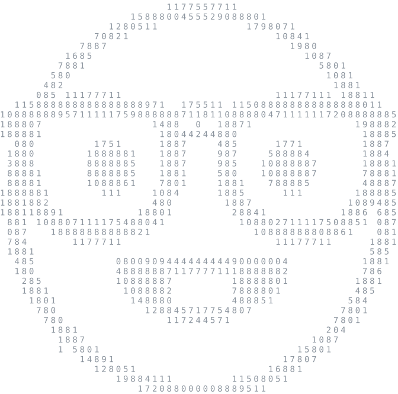

<!-- ===== HERO ===== -->


<p align="center">
  
</p>

```text
                In active searching work
 Studying Software Engineering at NSU FIT, class of '28.
       Background: C, Java, C++, GO, Python, Swift
```

<p align="center">
  <a href="https://t.me/USERNAME"></a>
  <a href="mailto:YOUR_EMAIL"></a>
  <a href="YOUR_HH_URL"></a>
</p>

<br clear="right">

<!-- ===== NEOFETCH ===== -->
<picture>
  <source media="(prefers-color-scheme: dark)" srcset="./assets/face-dark.svg">
  <source media="(prefers-color-scheme: light)" srcset="./assets/face-light.svg">
  
</picture>

```text
te1pe@github
─────────────────────────────
OS         macOS
Editor     Visual Studio
Languages  Go Java Python
Currently
Learning   Go
Work       ████████████  100%
```

<br clear="left">

<!-- ===== STACK ===== -->
<p align="center">
  
</p>

<p align="center">
  
</p>
<p align="center">
  
</p>

<p align="center">
  
</p>
<p align="center">
  
</p>

<p align="center">
  
</p>
<p align="center">
  
</p>

<p align="center">
  
</p>
<p align="center">
  
</p>

<!-- ===== PROJECTS ===== -->
Мои проекты
---

- ## [Cloute](https://github.com/te1pe/cloute)
  Теги: *#Go #TypeScript #CRDT #WebSocket*

  Совместный текстовый редактор, который разворачивается на своём сервере: несколько человек правят один документ в реальном времени и видят курсоры друг друга. Одновременные и офлайн-правки сливаются через CRDT (RGA), написанный вручную на Go и TypeScript и сверенный по общим тестовым векторам. Роли и ссылки доступа, комментарии с привязкой к символам, откат версий без потери одновременных правок, метрики Prometheus, один статический бинарник со встроенным фронтендом.

  [Документация](https://github.com/te1pe/cloute#readme)

---

- ## [foresight](https://github.com/te1pe/foresight)
  Теги: *#Go #Kafka #ClickHouse #мониторинг*

  Мониторинг, который прогнозирует исчерпание ресурсов до сбоя: «диск заполнится через 3 ч 20 мин». Сбор метрик собственным парсером формата Prometheus, Redpanda с доставкой at-least-once и хранение в ClickHouse без дублей, детекторы на EWMA z-score и методе наименьших квадратов, инциденты через transactional outbox и оповещения в Telegram. Проведено нагрузочное тестирование, цифры — в README.

  [Документация](https://github.com/te1pe/foresight#readme)

---

- ## [nsu-rag-llm](https://github.com/te1pe/nsu-rag-llm)
  Теги: *#Python #RAG #LLM #Qdrant*

  Вопросно-ответная система на RAG по учебным материалам ФИТ НГУ, которая подкрепляет каждое утверждение ссылкой на страницу. Парсинг и OCR почти 60 тыс. страниц, гибридный поиск (dense + BM25, RRF, реранк cross-encoder'ом), агент с маршрутизацией и переформулировкой запроса, LLM-судья, откалиброванный по ручной разметке. Работает локально на Ollama; 32 записи об архитектурных решениях.

  [Документация](https://github.com/te1pe/nsu-rag-llm#readme)

---

- ## [Pictor](https://github.com/te1pe/pictor)
  Теги: *#Swift #iOS #SwiftUI #ImageIO*

  Библиотека загрузки и кэширования изображений для iOS, написанная с нуля на Swift 6 — своя версия Nuke и Kingfisher. LRU-кэш памяти с синхронным доступом, чтобы картинка появлялась в первом же кадре ячейки, дисковый кэш, переживающий перезапуск, даунсэмплинг через ImageIO, дедупликация запросов и отмена по счётчику подписчиков, SwiftUI-view и предзагрузка. Без зависимостей, строгая конкурентность Swift 6, 115 тестов. В бенчмарках против Nuke и Kingfisher первый экран сетки готов в 3,4–4,7 раза быстрее, цифры — в README.

  [Документация](https://github.com/te1pe/pictor#readme)

---

- ## [Traty](https://github.com/te1pe/traty)
  Теги: *#Go #SQLite #self-hosted*

  Личный учёт расходов: HTML рендерится на сервере на Go и SQLite, без JavaScript-фреймворка и внешней базы данных. Деньги хранятся целыми числами в минимальных единицах, неделя начинается с понедельника, отчёты выгружаются в CSV. Интерфейс на русском и английском, светлая / тёмная / системная тема, устанавливается на телефон с экрана «Домой».

  [Документация](https://github.com/te1pe/traty#readme)

---

- ## [Obsidian Telegram Assistant](https://github.com/te1pe/obsidian-telegram-assistant)
  Теги: *#Python #C #автоматизация #macOS*

  Telegram-бот, который за секунду превращает сообщение в заметку Obsidian, а команду — в событие Календаря macOS или напоминание. Python на стандартной библиотеке, AppleScript и launchd, плюс небольшой лаунчер на C, который держит разрешения macOS на доступ к диску вместо интерпретатора.

  [Документация](https://github.com/te1pe/obsidian-telegram-assistant#readme)

---

- ## [Wishlist](https://github.com/te1pe/wishlist-ios)
  Теги: *#Swift #SwiftUI #iOS*

  iOS-приложение со списком желаний, данные только на устройстве: вещи с галереей фото, ценой и отметкой «куплено» хранятся локально как JSON плюс файлы изображений. SwiftUI с кэширующим хранилищем изображений, без аккаунтов, без сети и без сторонних зависимостей.

  [Документация](https://github.com/te1pe/wishlist-ios#readme)

---

- ## [llm-eval-ru](https://github.com/te1pe/llm-eval-ru)
  Теги: *#Python #NLP #оценка*

  Слепая попарная оценка двух русскоязычных LLM, воспроизводящая человеческий этап RLHF: скрипты для ослепления, проверки схемы, изолированного запуска кода из ответов и генерации отчёта. Только стандартная библиотека Python.

  [Документация](https://github.com/te1pe/llm-eval-ru#readme)

---

- ## [University Labs](https://github.com/te1pe/university-labs)
  Теги: *#C #C++ #Java #учёба*

  Монорепозиторий с учебными работами ФИТ НГУ: программирование на C, ООП на C++ и Java, архитектура ЭВМ, операционные системы, параллельное программирование, сети, базы данных, ООАД и методы трансляции.

  [Документация](https://github.com/te1pe/university-labs#readme)

---

- ## [University Notes](https://github.com/te1pe/university-notes)
  Теги: *#SystemVerilog #Python #конспекты*

  Конспекты лекций и лабораторные с первых курсов ФИТ НГУ: дискретная математика, теория вероятностей и математическая статистика, цифровая схемотехника на SystemVerilog и информатика.

  [Документация](https://github.com/te1pe/university-notes#readme)

---
